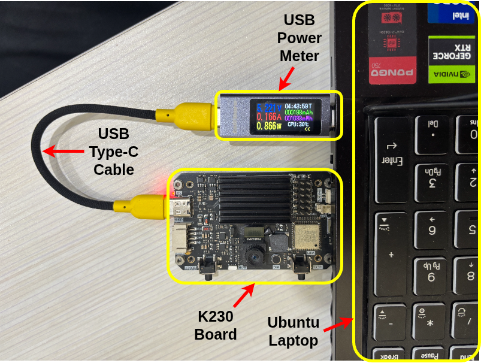
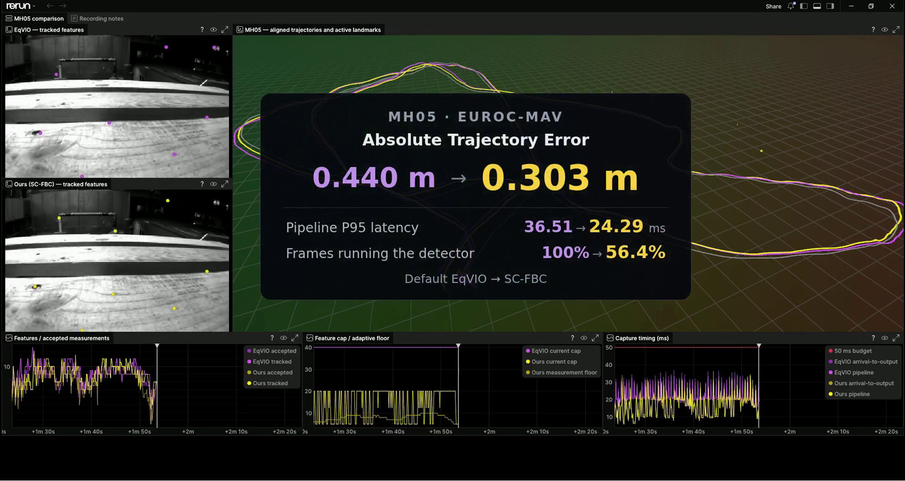
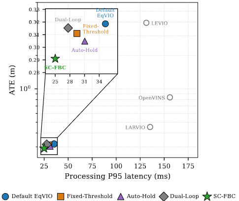
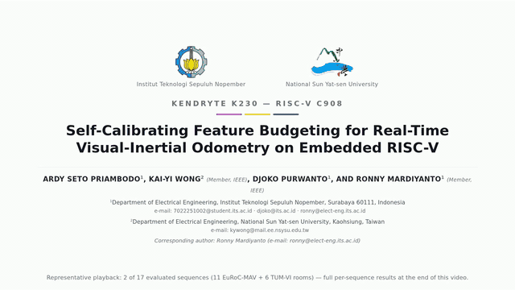

# SC-FBC
## Self-Calibrating Feature Budgeting for Real-Time Visual-Inertial Odometry on Embedded RISC-V

**Authors:** Ardy Seto Priambodo, Djoko Purwanto, and Ronny Mardiyanto from *Institut Teknologi Sepuluh Nopember (ITS)*; Kai-Yi Wong from *National Sun Yat-sen University (NSYSU)*.

<p align="center">
  
  
  
</p>

SC-FBC is a self-calibrating feature-budget controller for Visual-Inertial Odometry (VIO), evaluated natively on the Canaan Kendryte K230 with a 1.6 GHz XuanTie C908 RISC-V core. SC-FBC extends [EqVIO](https://github.com/pvangoor/eqvio) by switching the next-frame feature replenishment cap between 5 and 20 based on observations accepted by the filter.

**Features:**
- **Online Threshold Self-Calibration:** Continuously tracks scene observation statistics ($\tau_k$) to trigger replenishments only when genuinely needed.
- **Asymmetric Persistence Recovery ($H=5$):** Enforces multi-frame stabilization before lowering quotas, mitigating feature depletion in aggressive turns.
- **Native Embedded RISC-V Support:** Runs on the K230; whole-board power is measured at the USB-C input.
- **Lossless Real-Time Paced Replay:** 20 Hz timestamp-driven streaming reproduction faithfully evaluates edge latency deadlines.
- **Broad Sensor Support:** Tested on monocular pinhole (EuRoC-MAV) and equidistant fisheye (TUM-VI) models without sequence-specific tuning.

Under 20 Hz real-time streaming replay, SC-FBC achieves the **lowest mean ATE** among the evaluated pipelines (0.291 m on EuRoC-MAV, 0.511 m on TUM-VI) and reduces mean per-sequence P95 pipeline latency relative to Default EqVIO by **29.1% on EuRoC-MAV** and **15.2% on TUM-VI**.

**Video Demonstration:**

<div align="center">
  <a href="figures/k230-video.mp4">
    
  </a>
  <p><em>Real-time streaming replay on Kendryte K230 (click animation to play full video).</em></p>
</div>

**Related Manuscript:**
* **Self-Calibrating Feature Budgeting for Real-Time Visual-Inertial Odometry on Embedded RISC-V**, Ardy Seto Priambodo, Djoko Purwanto, Ronny Mardiyanto, Kai-Yi Wong.

---

## 1. Structure

- `src/`, `include/`, `libs/`, `external/`: EqVIO and SC-FBC source.
- `configs/`, `intrinsics.yaml`: estimator and camera configurations.
- `figures/`: hardware setup photo, performance plots, demo GIF, and video.
- `scripts/`: build and EuRoC/TUM-VI run entrypoints; `scripts-old/` preserves legacy tools.
- `other/`: LEVIO, LARVIO, and OpenVINS ports; each has its own README.
- `results/<method>/<dataset>/<sequence>/`: manuscript results for EqVIO,
  SC-FBC, LARVIO, OpenVINS, and LEVIO. Profiles and SC-FBC variants are nested
  within each sequence; SC-FBC power notes are in `results/SC-FBC/Power/`.
- `results/manuscript/`: generated sequence metrics, dataset means, and source
  hashes exported from the archived run summaries.

---

## 2. Prerequisites

### 2.1 Host Environment
- Ubuntu 20.04 / 22.04 LTS (x86_64)
- CMake 3.16+, GCC 9+, OpenCV 4.x, Eigen3

### 2.2 Canaan Kendryte K230 Toolchain
- Prepared `k230_linux_sdk` with `riscv64-unknown-linux-gnu-gcc`
- Target board: Canaan Kendryte K230 (1.6 GHz XuanTie C908, 1 GB RAM, Linux)

---

## 3. Build SC-FBC

### 3.1 Build on Host
```bash
bash scripts/build.sh --target host
```

### 3.2 Cross-Compile for Canaan K230
```bash
K230_SDK=/path/to/k230_linux_sdk bash scripts/build.sh --target k230
```

---

## 4. Run Experiments

Datasets are not included. Host inputs default to `~/dataset/EuRoC-MAV-376` and `~/dataset/TUM-VI-256`; K230 inputs default to `euroc_<sequence>` and `tumvi_<room>` under `/root/dataset/PGM-half`. Provision every sequence before running the loops.

### 4.1 EuRoC-MAV (11 Sequences, All Five Arms)
```bash
# Choose target: host or k230. For K230, set: TARGET=k230; SERIAL_ARGS=(--serial k230-02)
TARGET=host
SERIAL_ARGS=()

EUROC_SEQUENCES=(MH_01_easy MH_02_easy MH_03_medium MH_04_difficult MH_05_difficult
                 V1_01_easy V1_02_medium V1_03_difficult
                 V2_01_easy V2_02_medium V2_03_difficult)
for sequence in "${EUROC_SEQUENCES[@]}"; do
  bash scripts/run_euroc_mav.sh --target "$TARGET" --sequence "$sequence" \
    --resolution half --arm all "${SERIAL_ARGS[@]}"
done
```

### 4.2 TUM-VI (6 Room Sequences, All Five Arms)
```bash
TUMVI_ROOMS=(room1 room2 room3 room4 room5 room6)
for room in "${TUMVI_ROOMS[@]}"; do
  bash scripts/run_tum_vi.sh --target "$TARGET" --sequence "$room" \
    --resolution half --arm all "${SERIAL_ARGS[@]}"
done
```

Arm folders: `eqvio` → `EqVIO`, `hold-only` → `Auto-Hold`, `base-policy` → `Fixed-Threshold`, `sc-fbc` → `Dual-Loop`, `floor-only` → `SC-FBC`. Results are saved under `result/<target>/<arm>/{EuRoC-MAV/<sequence>,TUM-VI/<room>}/`. External-method build/run commands are in `other/{levio,larvio,openvins}/README.md`.

---

See `LICENSE` and the individual `other/` license files for licensing terms.

Thanks to [EqVIO](https://github.com/pvangoor/eqvio).
